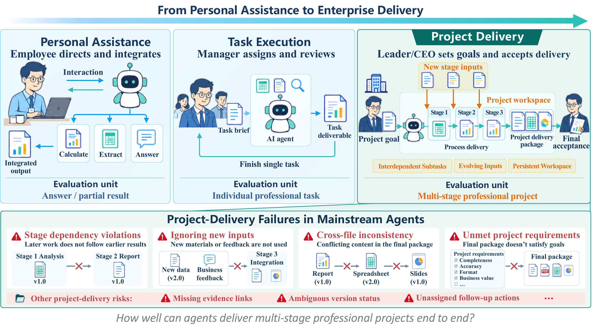
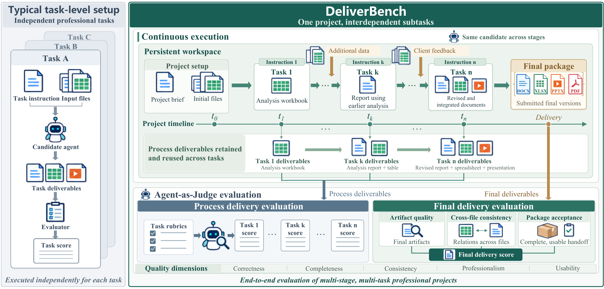
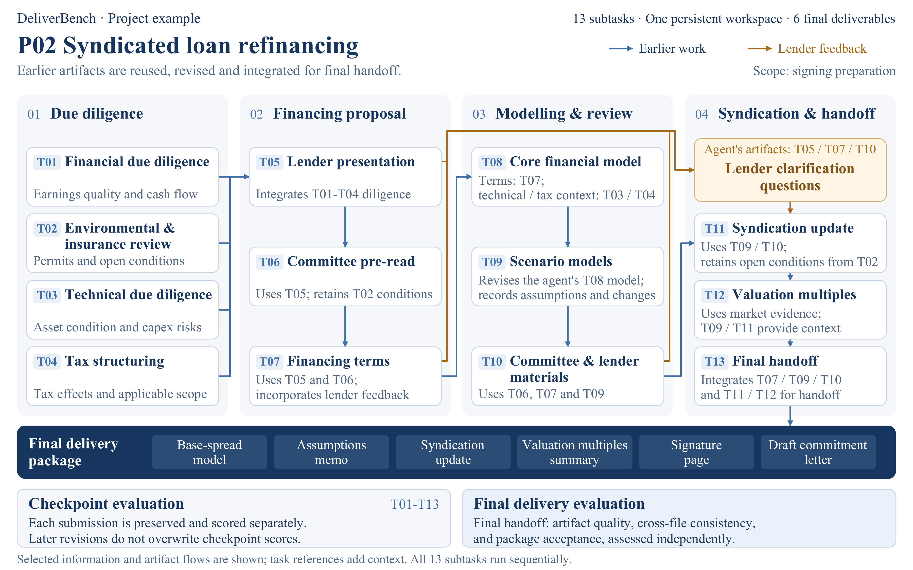

<p align="center">
  <a href="https://deliverbench.github.io/"></a>
</p>
<h1 align="center">DeliverBench</h1>
<p align="center"><strong>Benchmarking AI agents on continuous professional project delivery</strong></p>
<p align="center"><a href="https://deliverbench.github.io/">Project website</a> · <a href="https://huggingface.co/datasets/deliverbench/DeliverBench">Dataset</a> · <a href="#quick-start">Quick start</a> · <a href="README.zh-CN.md">中文</a></p>

DeliverBench evaluates how agents carry a professional project through evolving inputs,
interdependent tasks, and a final multi-file handoff. The agent stays in one persistent
workspace, revises its own earlier work, and responds to new materials and feedback.

[](assets/figure-01-motivation.png)

<sub>Figure 1 · The evaluation unit expands from individual tasks to a complete professional project.</sub>

## Three public cases

| Case | Professional workflow | Stages | Explore |
|:---|:---|:---:|:---|
| **Case 01** | Project Mars Refinancing | 13 | [Files](https://huggingface.co/datasets/deliverbench/DeliverBench/tree/main/projects/case-01_mars_refinancing) · [ZIP](https://huggingface.co/datasets/deliverbench/DeliverBench/resolve/main/archives/DeliverBench-Case01.zip?download=true) |
| **Case 02** | Pharmacovigilance ICSR | 12 | [Files](https://huggingface.co/datasets/deliverbench/DeliverBench/tree/main/projects/case-02_pv_icsr) · [ZIP](https://huggingface.co/datasets/deliverbench/DeliverBench/resolve/main/archives/DeliverBench-Case02.zip?download=true) |
| **Case 03** | StarPulse Legal Delivery | 8 | [Files](https://huggingface.co/datasets/deliverbench/DeliverBench/tree/main/projects/case-03_starpulse_legal) · [ZIP](https://huggingface.co/datasets/deliverbench/DeliverBench/resolve/main/archives/DeliverBench-Case03.zip?download=true) |

Each case also has one independent FINAL evaluation. This public collection contains
three complete projects; it is not the entire research collection.

## Quick start

Requirements: Python 3.12, uv, Docker with Compose, and at least 8 GiB allocated to
Docker. Image builds download public dependencies. Allow additional disk space for
images and your own run artifacts.

```sh
git clone https://github.com/theseus-labs-rsi/deliverbench.git
cd deliverbench
uv venv --python 3.12 .venv
uv pip install --python .venv/bin/python uv ./deliverbench-harbor -r requirements-tools.txt
source .venv/bin/activate
python scripts/download_data.py --project all --output-dir data
harbor --version
harbor plugins list
```

The downloader pins a dataset commit in `data_release.json` and verifies every
project file. `--project case-01`, `case-02`, or `case-03` downloads one project. An identical
existing project is reused; changed files or extra files cause a refusal instead of
an overwrite. The optional `--source-dir` reads a previously downloaded Hub snapshot.

## How delivery works

[](assets/figure-03-execution.png)

<sub>Figure 3 · The same agent carries its work across stages. Checkpoints and the final delivery package are evaluated separately.</sub>

The opening background is unscored. Stage inputs are released at their designated
time; the agent carries its own artifacts forward. Authored reference files, rubrics,
future materials, and simulator internals are not made available in the Candidate
workspace by the runner. Public availability of those files does not permit an
evaluation agent to retrieve them from the public repository.

Each scored unit freezes its evidence and receives complete criterion judgments.
Process and FINAL evaluations assess different submitted versions; FINAL does not
average process scores or inherit previous hurdle hits. Missing judgments, unreadable
evidence, and workflow errors are not converted into valid zero scores. A genuine
hurdle violation can produce a valid zero. See [the scoring contract](deliverbench-harbor/README.md).

The public repositories contain task definitions and software only. They contain no
model submissions, benchmark scores, judgments, execution traces, or run reports.

## A project in practice

[](assets/figure-08-dependencies.png)

<sub>Figure 8 · Case 01: earlier analyses, models, and lender feedback feed into a six-file final handoff. Original paper artwork.</sub>

## Check the installation

Run the complete pipeline with authored reference fixtures and local synthetic
Judge/Responder services. No paid model API is used. The output directory must be new.

```sh
python data/case-01_mars_refinancing/qa/pipeline_probe.py --output "$PWD/checks/case-01"
```

Use the corresponding project directory for Case 02 or Case 03. These checks exercise the
execution protocol; their synthetic judgments do not measure model performance.

## Run your model

Configure credentials in your shell; `.env.example` is a template and is not loaded
automatically. Candidate, Judge, and Responder calls may have separate costs.
The default Codex configuration requires a compatible Responses API. The Responder
uses structured Chat Completions and defaults to the Judge credentials.

```sh
export OPENAI_API_KEY='<candidate-api-key>'
export OPENAI_BASE_URL='<candidate-base-url>'
export JUDGE_API_KEY='<judge-api-key>'
export JUDGE_BASE_URL='<judge-base-url>'
export JUDGE_MODEL='<judge-model>'
export RESPONDER_API=chat
cd data/case-01_mars_refinancing
harbor run -c harbor_job.yaml -a deliverbench_harbor.agents:Codex -m '<candidate-model>' --resume-trajectory --plugin deliverbench --job-name case-01-my-model
deliverbench-check jobs/case-01-my-model --verify-evidence
```

Model-specific configuration examples are included with each project. Inspect their
provider route and pinned tool version before use. Keep Judge and Responder settings
fixed when comparing agents. See [running and scoring](docs/RUNNING.md).

## Development

`deliverbench-harbor/qa` contains protocol tests. Run
`python scripts/check_release.py --data-dir data --output-dir checks/release`
from the repository root in the environment above. This runs offline checks; use each
project's `pipeline_probe.py` separately for Docker integration checks. Generated
reports and run artifacts remain in your local output directory.

The shared extension is 0.7.2 and requires stock Harbor
0.20.0. This project does not vendor Harbor or require private container images.

## License and citation

Code is licensed under [Apache-2.0](LICENSE). [Presentation figures](assets/README.md)
and dataset content are CC BY 4.0; executable files shipped with the dataset are Apache-2.0. See the dataset's licensing notice.
[CITATION.bib](CITATION.bib) provides software and dataset references.
